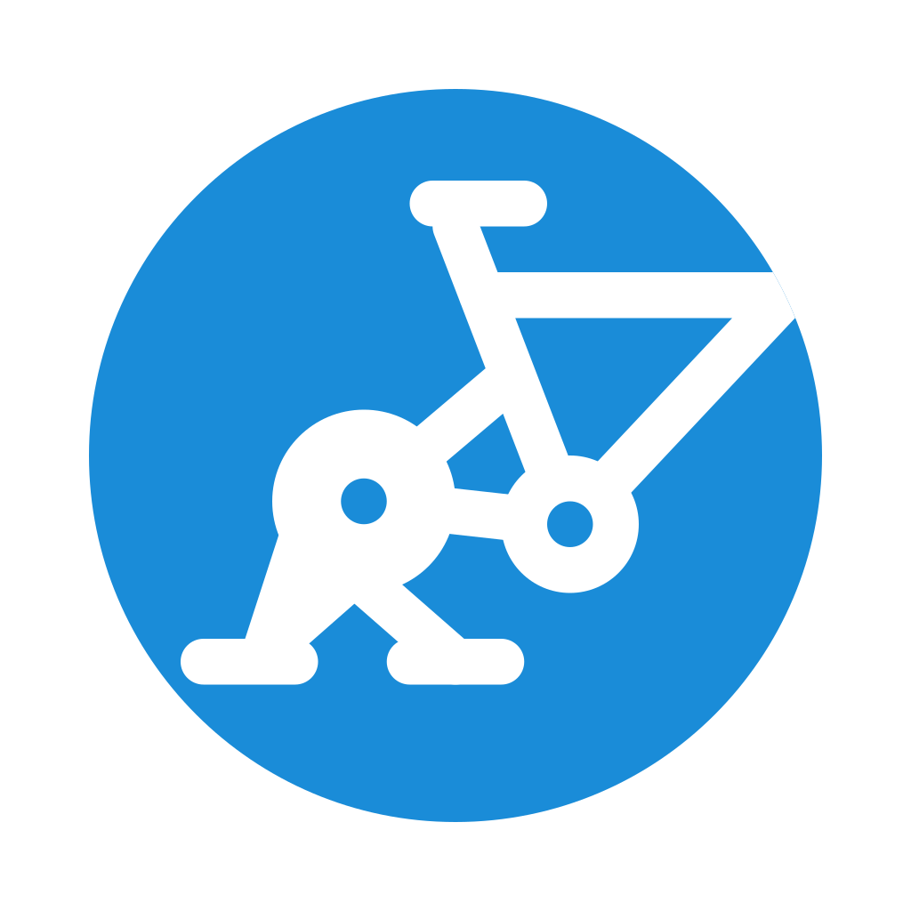
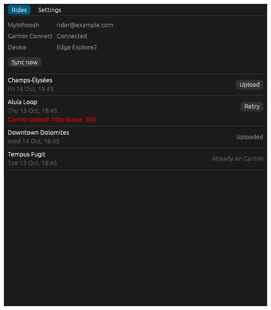
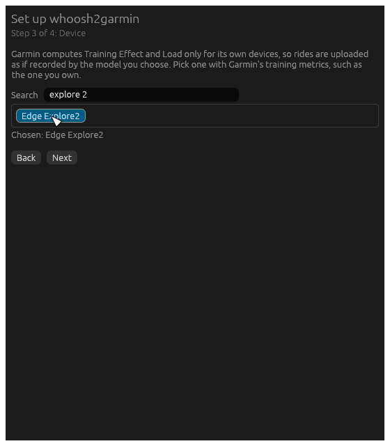

<p align="center"></p>

# Domestique

Domestique syncs your [MyWhoosh](https://mywhoosh.com) rides to Garmin Connect, rewritten as if
a Garmin device had recorded them, so Garmin computes Training Effect and Training Load for them.

For each ride Garmin doesn't have yet, it:

1. takes the ride file from your MyWhoosh account, or the one MyWhoosh saved on this computer,
2. sets the device to the Garmin model you pick,
3. adds the lap MyWhoosh leaves out after the last workout step (the cool-down),
4. uploads it to Garmin Connect and names the activity after the MyWhoosh ride.

It sits in the system tray and syncs by itself: a couple of minutes after each ride when MyWhoosh
runs on the same computer, every 30 minutes otherwise. A command line, `domestique-cli`, does the
same from a terminal or a scheduled task.

<p>
  
  
</p>

> **Unofficial.** Domestique is not affiliated with or endorsed by MyWhoosh or Garmin. Neither
> offers an API for this, so it uses the private APIs their own apps use. It can break whenever
> either of them changes those, and using it may go against their terms of service. Use it with
> your own accounts only.

## Install

Download the file for your system from the
[Releases page](https://github.com/mikaellecam/domestique/releases). Each one holds the app, the
command line, the licence and the licences of the libraries it is built with
(`THIRD_PARTY_LICENSES.html`).

**Start with the computer** remembers where the program is, so put it where it will stay before
you run it the first time. If you move it later, start it once from its new place.

**Windows**, `domestique-windows-x86_64.zip`: unzip it to a folder of its own, for example
`%LOCALAPPDATA%\Programs\Domestique`, and run `domestique.exe`. The app isn't signed, so
SmartScreen warns about it the first time: click **More info**, then **Run anyway**.

**Linux**, `domestique-linux-x86_64.tar.gz`: extract it to a folder you'll keep and run
`domestique`. MyWhoosh has no Linux version, so your rides come from your MyWhoosh account, which
Domestique checks every 30 minutes. The tray icon needs a desktop that shows StatusNotifierItem
icons: KDE Plasma does; on GNOME, install the AppIndicator extension.

**macOS**, `domestique-macos-arm64.zip` (Apple silicon): experimental and untested. It holds
`Domestique.app` and `domestique-cli`. Move `Domestique.app` to Applications and open it. It isn't
signed, so macOS may block it at first; allow it in System Settings → Privacy & Security.
Notifications show under Script Editor's name.

**From source**, with Rust 1.95 or newer: `cargo build --release` builds
`target/release/domestique` and `target/release/domestique-cli`.

## Setup

The first run opens a window with four steps:

1. **MyWhoosh**: sign in with your MyWhoosh account. If MyWhoosh is installed on this computer you
   can skip this, and Domestique reads the file MyWhoosh saves here instead. That file only ever
   holds your latest ride; an account adds your past rides and the ones you do on other devices.
2. **Garmin Connect**: **Sign in with Garmin** opens Garmin's sign-in page in your browser. Your
   password and MFA code are typed there only; Domestique receives a session, which it renews by
   itself.
3. **Device**: pick the Garmin model your rides will look recorded by. Garmin computes Training
   Effect and Load only for its own devices, so choose one that has its training metrics, such as
   the one you own.
4. **Your rides**: your rides of the last 7 days and whether Garmin has them. Tick the ones to
   upload, and choose how new rides are uploaded: **Automatically** or **Ask me first**. The rides
   you leave unticked are marked Skipped, and Domestique won't upload them unless you ask it to
   from the Rides tab.

## Day to day

Domestique then runs in the tray and starts with the computer. Click the icon, or choose **Open**
in its menu, to open the window; starting Domestique again while it runs does the same. The menu
also has **Sync now** and a line saying how the last sync went, and the icon changes when
something needs you: a ride waiting for you, or a failed upload or sync.

A sync looks at your rides of the last 7 days (the look-back in Settings), finds the ones Garmin
is missing and, with automatic uploads, uploads them. It runs:

- a minute after Domestique starts, to give the network time to come up at login,
- after each ride, when MyWhoosh is installed on the same computer (Windows and macOS): Domestique
  watches the file MyWhoosh saves the ride to, and syncs once it has been left alone for two
  minutes,
- every 30 minutes, if **Check every 30 minutes** is on, for rides done in MyWhoosh on another
  device (it is on from the start when MyWhoosh isn't installed on the computer),
- when you click **Sync now**.

A sync that fails is tried once more, 15 minutes later.

Notifications tell you when a ride is uploaded, when a new ride is waiting for you, and when an
upload or a sync fails, including when Garmin wants you to sign in again (Settings → **Sign in
again**). On Windows, clicking a notification opens the window, and a waiting ride's notification
has an **Upload** button.

With **Ask me first**, a new ride missing from Garmin waits as "Not on Garmin" until you upload
it from the Rides tab, or from its notification on Windows. Without a MyWhoosh account, upload it
before your next ride: MyWhoosh overwrites its file with each ride.

The **Rides** tab lists the rides the last sync found: Already on Garmin, Uploaded, Not on Garmin,
Skipped, or Failed with the reason. Rides that aren't on Garmin have an **Upload** button, failed
ones **Retry**.

### Already on Garmin

Before uploading, Domestique reads your Garmin activity list. A ride counts as already there when
a Garmin activity was under way when the ride started, or began up to 5 minutes after it: the
same ride recorded on a watch, for example. Those rides are left alone, so nothing counts twice.

Each sync's result is kept in `status.json`, next to the settings. That is how a ride Domestique
uploaded keeps showing as Uploaded rather than Already on Garmin, and how a ride you skipped stays
skipped. A failed upload is tried again by the next sync.

## Settings

Every change in the **Settings** tab is saved at once:

- **MyWhoosh**: change the account, or remove it when MyWhoosh is installed on this computer.
- **Garmin Connect**: sign in again, or sign out.
- **Device**: the Garmin model rides are uploaded as.
- **Upload new rides**: Automatically or Ask me first.
- **Start with the computer**: on by default.
- **Sync after each ride**: only when MyWhoosh is installed on this computer.
- **Check every 30 minutes**.
- **Look back**: how many days a sync covers, 7 by default.

The tray starts following **Sync after each ride** and **Check every 30 minutes** when you close
the window.

## Your data

Domestique has no server of its own: it talks to MyWhoosh and Garmin directly. It keeps its files
in:

- Windows: `%APPDATA%\domestique\`
- macOS: `~/Library/Application Support/domestique/`
- Linux: `~/.config/domestique/`, or `$XDG_CONFIG_HOME/domestique/`

`config.json` holds the settings, your MyWhoosh email and password, and the Garmin session. It is
plain-text JSON, because Domestique runs unattended and can't ask for a keyring password. On Linux
and macOS only your user can read it; on Windows it sits in your user profile. Your Garmin password
and MFA code are never stored: you type them on Garmin's own page, not in Domestique.

`status.json` holds the rides of the last sync, and `tray.lock` and `tray.port` keep a single tray
running.

To remove Domestique, turn off **Start with the computer**, quit it from the tray, then delete the
program and this folder.

## Command line

`domestique-cli` runs a sync from a terminal. It shares the app's settings and sign-ins, so after
the app's setup it needs nothing more.

```sh
domestique-cli login                   # sign in to MyWhoosh (optional) and Garmin
domestique-cli sync --dry-run          # list recent rides and whether Garmin has them
domestique-cli sync                    # upload the rides Garmin doesn't have yet
domestique-cli sync --days 90          # look further back, e.g. to catch up
domestique-cli devices                 # list the device names, e.g. edge_explore2
domestique-cli rewrite in.fit out.fit --device edge_explore2   # rewrite one file, no upload
```

- `login` asks for your MyWhoosh email and password, then opens Garmin's sign-in page in your
  browser. Leave the email empty to skip MyWhoosh; an account saved earlier is kept.
- `sync` takes the device and the look-back from the app's settings; `--device NAME` and
  `--days N` override them for one run. Without a device in the settings, `--device` is required.
  It always uploads, whatever **Upload new rides** says, but leaves skipped rides alone. Times are
  printed in UTC. `--dry-run` uploads nothing.
- Pick a device with Garmin's training metrics; most Edge, Forerunner and Fenix models have them.

If Garmin ends the session, `sync` fails asking you to sign in to Garmin again: run `login` again.

### On a schedule

If you'd rather not keep the tray running, turn off **Start with the computer**, quit the tray,
and run `sync` on a schedule instead, for example every hour (leave out `--device` if the app's
settings have one):

- Linux and macOS, with `crontab -e`:
  `0 * * * * /path/to/domestique-cli sync --device edge_explore2`
- Windows:
  `schtasks /create /sc hourly /tn Domestique /tr "%LOCALAPPDATA%\Programs\Domestique\domestique-cli.exe sync --device edge_explore2"`

## Credits

Domestique builds on what these projects worked out:

- [jdelrue/mywoosh2garmin](https://github.com/jdelrue/mywoosh2garmin) and
  [iquesada/mywhoosh2garmin](https://github.com/iquesada/mywhoosh2garmin): MyWhoosh's API, and
  rewriting its files so Garmin accepts them as its own.
- [matin/garth](https://github.com/matin/garth): the Garmin Connect sign-in flow.
- [rustyfit](https://github.com/muktihari/rustyfit): FIT decoding and encoding.

## Licence

MIT, see [LICENSE](LICENSE).
